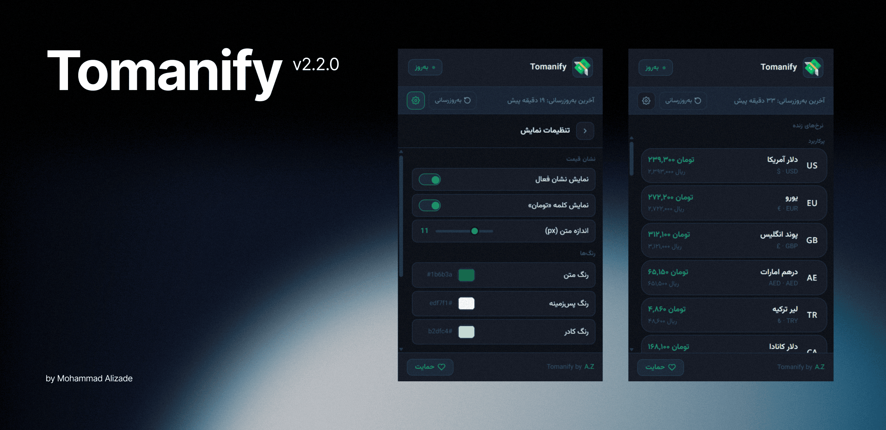

# Tomanify by A.Z

**Convert any price on the web to Iranian Toman in real time.**

Live exchange rates from [alanchand.com](https://alanchand.com). Works on Amazon, eBay, AliExpress, and almost every website that shows prices in USD, EUR, GBP, AED, and 30+ other currencies.

---

## Features

- 🔄 **Live rates** — Refreshed automatically (and on demand)
- 🏷️ **Inline badges** — Toman equivalent appears next to any price
- 🌐 **Universal** — Works on virtually any website
- ⚙️ **Customizable** — Badge size, colors, show/hide “تومان”
- 🇮🇷 **Persian formatting** — Smart میلیون / میلیارد display

---

## Installation (Developer Mode)

1. Download or clone this repository
2. Open Chrome → `chrome://extensions`
3. Enable **Developer mode** (top right)
4. Click **Load unpacked** and select the `tomanify` folder
5. Open the popup and click **به‌روزرسانی** once

---

## How it works

Tomanify scans the page for price patterns (currency symbols + numbers), converts them using live rates from alanchand.com, and injects a small badge next to each price.

Rates are cached for one hour. If they become older than that, the popup shows **منقضی** and refreshes in the background.

---

## Project structure

tomanify/
├── manifest.json      # Chrome MV3 manifest
├── background.js      # Rate fetcher & cache
├── content.js         # Page scanner & badge injector
├── utils.js           # Shared formatters & parsers
├── popup.html         # Popup UI
├── popup.js           # Popup logic
├── icons/             # Extension icons
├── LICENSE
└── README.md

---

## Support the project

If you enjoy Tomanify, you can support development with USDT:

**USDT (BNB / BEP20)**  
`0x2Bf99Bf8EB11BEC0fC74A15CB2Ba8c6b9161EFF9`

---

## Author

**Mohammad Alizade (A.Z)**  
GitHub: [@Mohammad-Alizade](https://github.com/mohamadaz-apps)

---

## License

MIT © Mohammad Alizade (A.Z)

---

 

# تومانیفای (Tomanify) از A.Z

**تبدیل لحظه‌ای هر قیمت در وب به تومان ایران**

نرخ‌های زنده از [alanchand.com](https://alanchand.com). روی آمازون، eBay، علی‌اکسپرس و تقریباً هر سایتی که قیمت را به دلار، یورو، پوند، درهم و بیش از ۳۰ ارز دیگر نشان می‌دهد کار می‌کند.

---

## امکانات

- 🔄 **نرخ زنده** — به‌روزرسانی خودکار و دستی
- 🏷️ **نشان قیمت** — معادل تومان کنار هر قیمت نمایش داده می‌شود
- 🌐 **فراگیر** — روی تقریباً همه سایت‌ها کار می‌کند
- ⚙️ **قابل تنظیم** — اندازه، رنگ و نمایش کلمه «تومان»
- 🇮🇷 **فرمت فارسی** — نمایش هوشمند میلیون و میلیارد
  
---

## نصب (حالت توسعه‌دهنده)

1. این مخزن را دانلود یا کلون کنید
2. کروم را باز کنید → `chrome://extensions`
3. **Developer mode** را فعال کنید
4. روی **Load unpacked** کلیک کنید و پوشه `tomanify` را انتخاب کنید
5. پاپ‌آپ را باز کنید و یک بار روی **به‌روزرسانی** بزنید

---

## نحوه کار

تومانیفای صفحه را برای الگوهای قیمت (نماد ارز + عدد) اسکن می‌کند، با نرخ زنده از alanchand.com تبدیل می‌کند و یک نشان کوچک کنار هر قیمت قرار می‌دهد.

نرخ‌ها یک ساعت کش می‌شوند. اگر قدیمی‌تر شوند، در پاپ‌آپ **منقضی** نمایش داده می‌شود و در پس‌زمینه به‌روز می‌گردند.

---

## حمایت از پروژه

اگر از تومان‌فای لذت می‌برید، می‌توانید با ارسال USDT از توسعه آن حمایت کنید:

**USDT (BNB / BEP20)**  
`0x2Bf99Bf8EB11BEC0fC74A15CB2Ba8c6b9161EFF9`

---

## نویسنده

**محمد علیزاده (A.Z)**  
گیت‌هاب: [@Mohammad-Alizade](https://github.com/mohamadaz-apps)

---

## مجوز

MIT © محمد علیزاده (A.Z)
